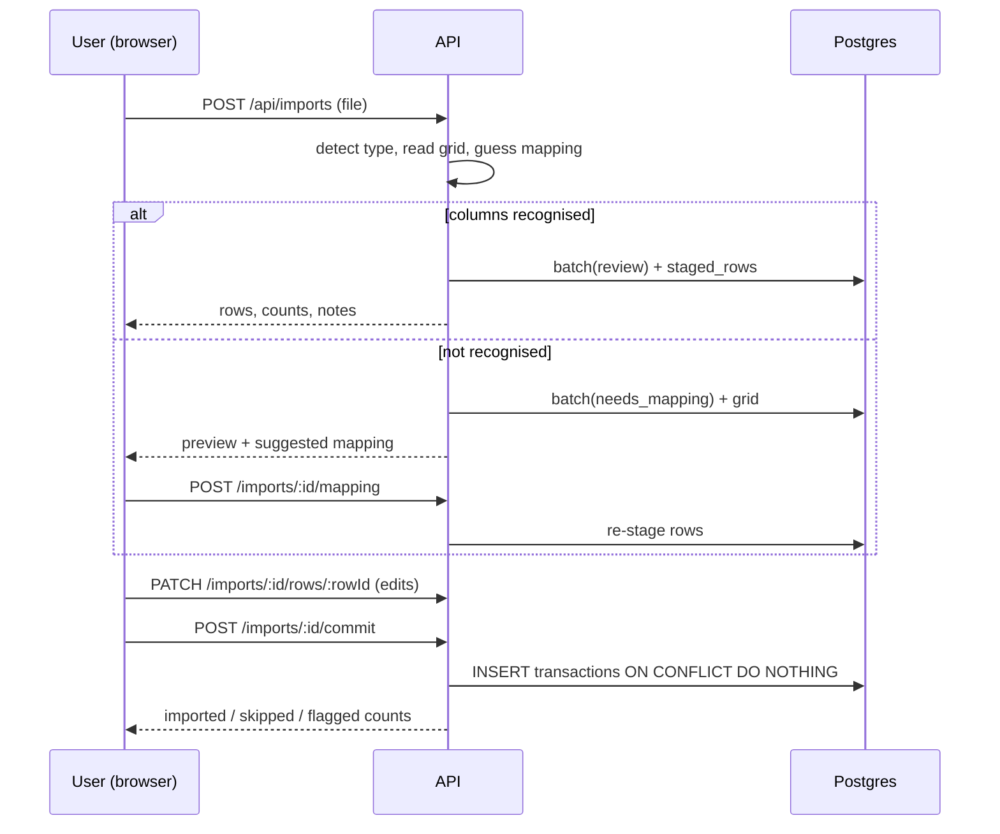
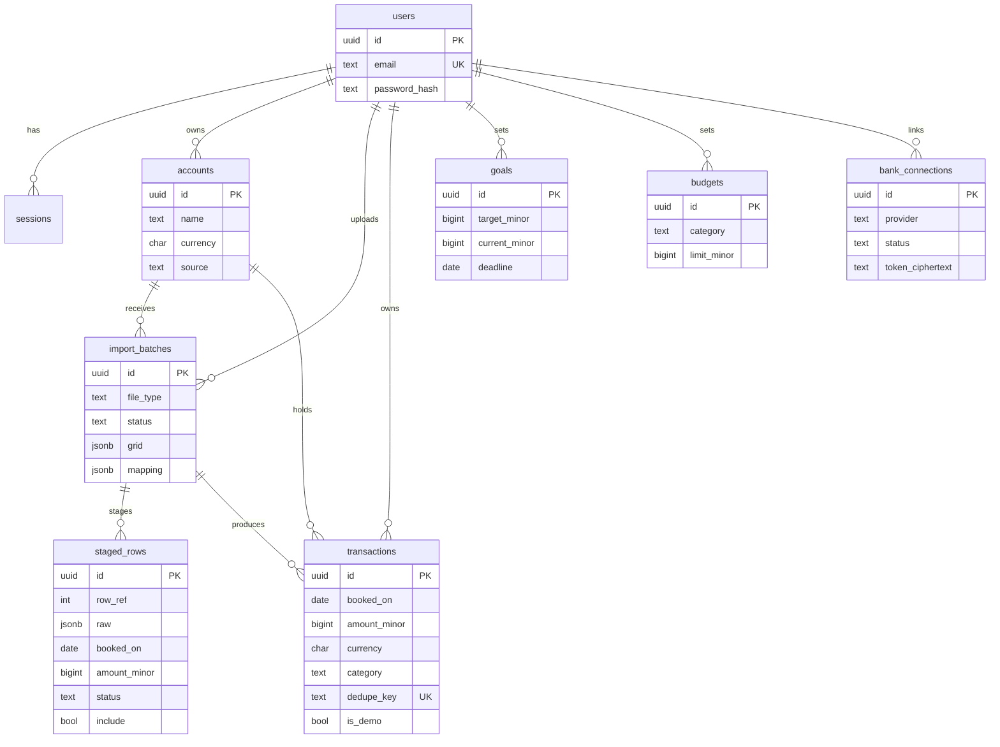

# Architecture (as built)

## Stack

React + TypeScript (Vite) · Node.js + Express + TypeScript · PostgreSQL via `pg` · zod validation · vitest + supertest.

## Server modules (`backend/src`)

| Module                                   | Responsibility                                                                 |
| ---------------------------------------- | ------------------------------------------------------------------------------ |
| `auth.ts`, `routes/auth.ts`              | scrypt hashing, session cookie, `requireAuth`                                  |
| `import/readers.ts`, `import/pdf.ts`     | CSV/XLSX/PDF → grid of cells (PDF via pdfjs-dist, no eval)                     |
| `import/normalize.ts`                    | header/column guessing, row staging, direction inference, duplicate keys       |
| `money.ts`, `dates.ts`                   | integer minor-unit parsing/formatting, date parsing/order inference            |
| `categorize.ts`                          | keyword categorization (Unicode-aware boundaries)                              |
| `analytics.ts`                           | summaries, trends, recurring detection, monthly net estimate (pure functions)  |
| `goals.ts`                               | deterministic goal plan + affordability (pure)                                 |
| `ai/assistant.ts`, `routes/assistant.ts` | fact builder, deterministic fallback, optional Anthropic call, grounding check |
| `banks/provider.ts`, `routes/banks.ts`   | provider interface, empty registry, status                                     |
| `routes/*`                               | HTTP layer; `app.ts` has helmet, JSON limits, central error handler            |
| `migrate.ts`, `migrations/`              | forward-only SQL migrations                                                    |

## Import flow

## Assistant flow

Question → load **only the caller's** transactions/goals → `buildFacts` (deterministic, all arithmetic here) → if no API key or no data: return deterministic text; otherwise send aggregates + question to the model, require `{"answer": ...}`, reject any number not present in the supplied facts, fall back on any failure. Evidence rows always come from the backend, not the model.

## ERD

## Key decisions

- `amount_minor` is a signed BIGINT; read back as a JS number with a safe-integer guard.
- Dedupe key = hash(account, date, amount, currency, normalized description, occurrence index) so legitimate repeats in one file survive but re-uploads are caught.
- The parsed grid is stored on the batch so a column mapping can be re-applied without keeping the uploaded file.
- "Today" can be pinned with `FINUP_TODAY` for deterministic tests.
