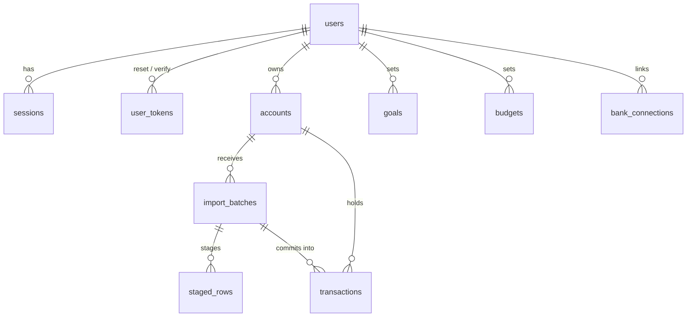

# Database

PostgreSQL 14+. Forward-only SQL migrations in `backend/migrations/`, applied automatically on API start (`npm run migrate`). All money is stored as signed integer **minor units** (`BIGINT`) with an ISO currency code; amounts of different currencies are never summed.

| Table              | Purpose                                                                 |
| ------------------ | ----------------------------------------------------------------------- |
| `users`            | email (unique) + scrypt password hash                                   |
| `sessions`         | SHA-256 of the session token, expiry                                    |
| `user_tokens`      | single-use password-reset / email-verify tokens (hashed, expiring)      |
| `accounts`         | statement / bank / demo account with a currency                         |
| `import_batches`   | an uploaded file: parsed grid, column mapping, status                   |
| `staged_rows`      | rows awaiting review (`ok`, `flagged`, `duplicate`, `invalid`)          |
| `transactions`     | confirmed transactions only; analytics and the assistant read just this |
| `goals`, `budgets` | savings goals and per-category limits                                   |
| `bank_connections` | reserved for a future licensed bank provider (no live sync today)       |
